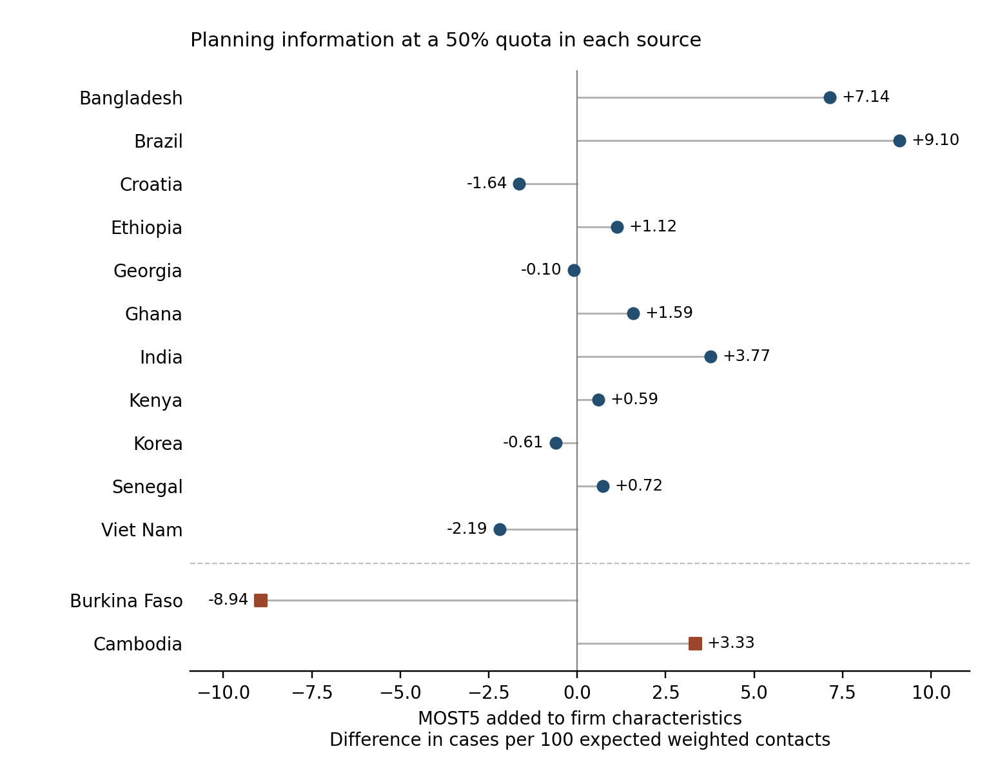
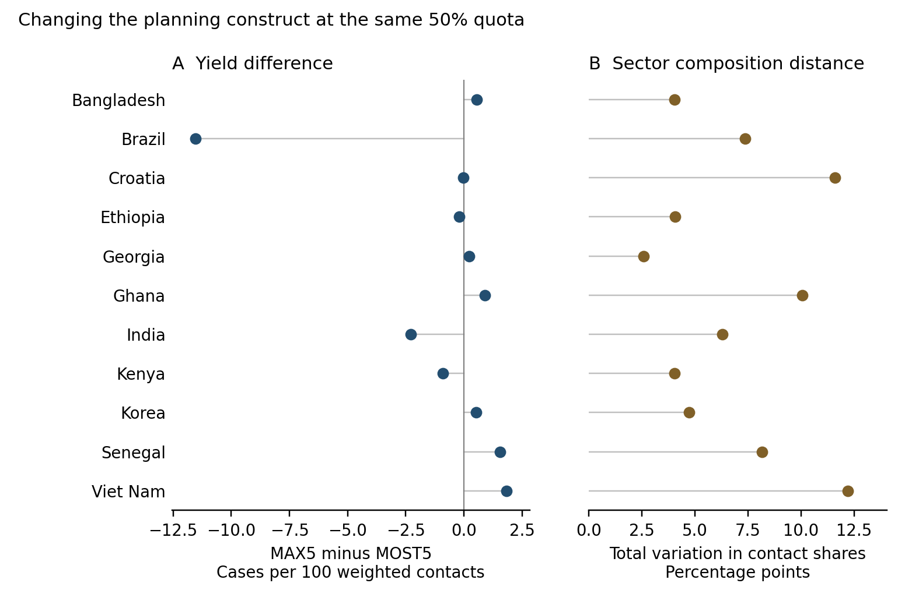
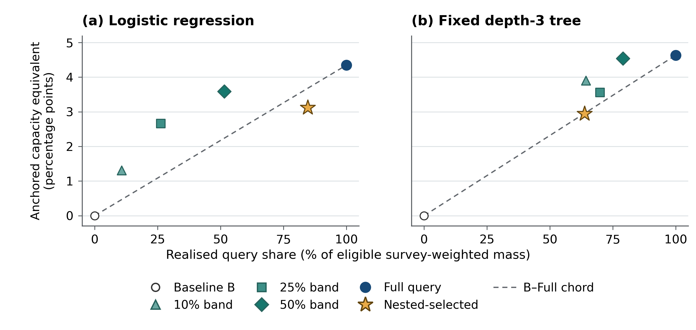
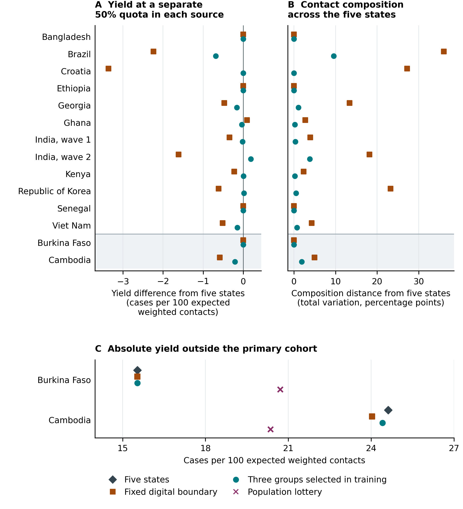
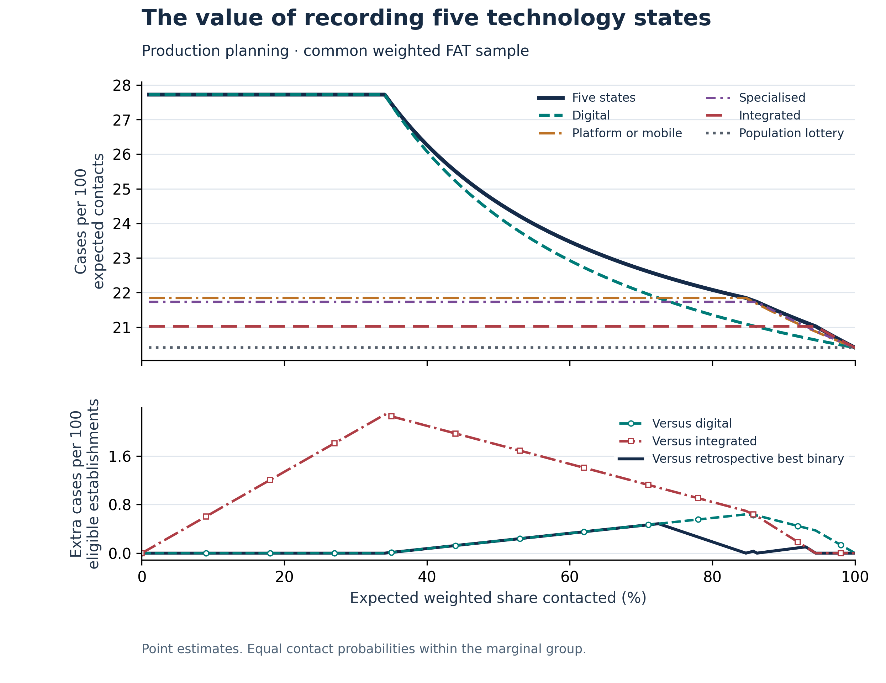
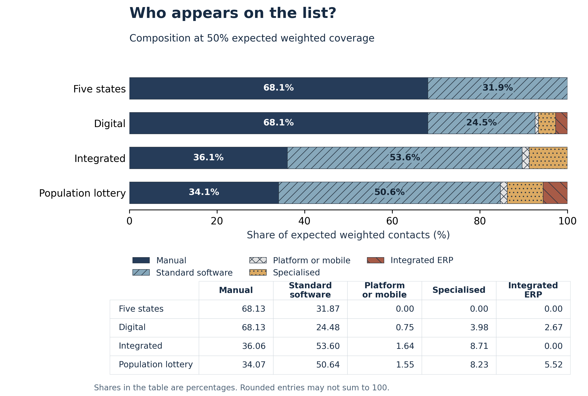
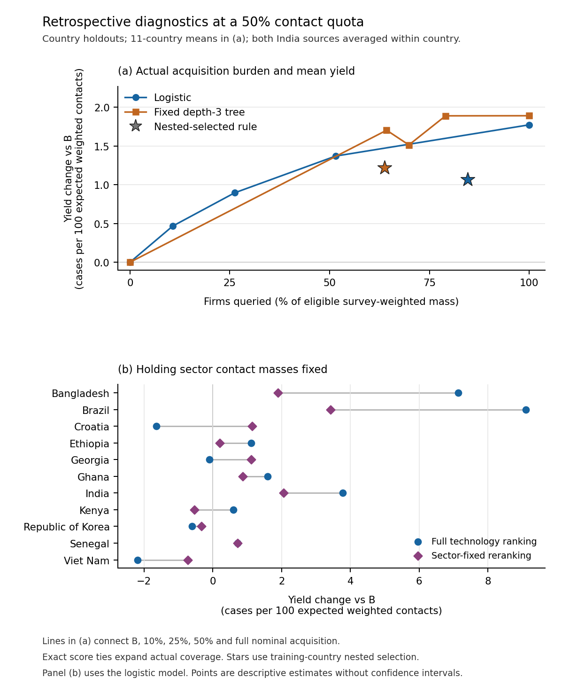

# Figure gallery

The seven article figures are supplied as PNG previews, editable SVGs, native LibreOffice Draw ODG files and vector PDFs. Captions and descriptions match the current article artwork kit. The manuscript is distributed separately.

## Regenerate the plotted results

From the repository root, using the documented Python 3.12 environment:

```sh
python -B reproduce.py --mode figures --output /absolute/new_six_figures
python -B h7_capacity/reproduce.py --output /absolute/new_capacity
```

The first command regenerates Figures 1, 2 and S1–S4 from the eight archived CSV inputs. The second derives Figure 3 and the capacity tables from the archived H7 aggregates. Each output directory must be new and outside the repository. Neither command reads microdata or fits models. The unchanged top-level `reproduce.py --mode all` includes the six original figures and does not call the separate capacity command.

Install the complete dependency lock from `h7_capacity/requirements-complete-linux-py312.txt` for the capacity command. It includes the native ODG converter's `lxml` dependency. The tested platform is Linux/Python 3.12.14; these instructions do not certify native Windows or macOS execution.

The six-figure command writes PNG, SVG and PDF outputs. Figure 3 is written under `derived/` as `Figure_3_capacity_q50.png`, `.svg`, `.pdf` and `.odg`; the repository gallery uses the shorter `Figure_3` filename. The supplied `native_odg/` files are the separately checked Draw editions. They are not regenerated by the six-figure plotting command. Creation metadata may differ when files are regenerated. Numerical and structural checks are distinct from byte comparisons.

`INPUT_IDENTITIES.json` records the eight original figure inputs. The capacity command checks its input hashes using `h7_capacity/INTEGRATION_PROVENANCE.json`. Its explicit input route is `reported_results/H7/` in the repository root; it does not automatically consume newly fitted analytical outputs.

## Edit the artwork

Open a file from `native_odg/` in LibreOffice Draw. Text, paths, fills, strokes and point coordinates are editable objects. These drawings are not data-linked charts: editing a label does not update the underlying calculation, axis or series. Recalculate the results and update the corresponding artwork together when data or methods change.

The exact DejaVu Sans 2.35 regular and bold fonts used for the checked Draw exports are supplied in `fonts/`, with their licence notice. Install those fonts when matching the checked appearance. Preserve the font notice when redistributing them. The supplied vector PDFs provide a reference for visual comparison; the SVGs provide an alternative editable vector format.

## Numbering

Figures 1 and 2 report conditional comparisons. Figure 3 shows query share and anchored baseline-equivalent contact capacity. S1 contains the original coding-transfer comparison, S2 and S3 the original pooled yield and composition figures, and S4 selective querying and sector-fixed allocation. `FIGURE_NUMBERING.tsv` maps the current figure names to their input folders and original exports. `CAPTIONS.md` and `ALT_TEXT.md` contain the corresponding text.

## Figure 1



Incremental planning yield from adding five-state MOST to B at a 50% quota within each source. The primary results exclude the scored country from estimation, averaging the two India sources within country. Secondary targets are scored after training on all twelve primary sources and are displayed separately. Horizontal segments run from zero to the fixed logistic yield contrast; no confidence intervals are shown.

[Editable ODG](native_odg/Figure_1.odg) · [Editable SVG](editable_svg/Figure_1.svg) · [Vector PDF](vector_pdf/Figure_1.pdf) · [Primary CSV](inputs/main/Figure_1_primary.csv) · [Secondary CSV](inputs/main/Figure_1_secondary.csv)

<details>
<summary>Detailed figure description</summary>

At a separate 50% expected weighted quota in each source, dots show the increase or decrease in low-sales-per-worker case yield after adding most-used planning technology to the same firm-characteristic baseline. Bangladesh and Brazil have large positive increments; four primary countries have negative increments. Separate squares show Burkina Faso at −8.94 and Cambodia at +3.33 cases per 100 expected weighted contacts. Horizontal segments join each contrast to zero and are not uncertainty intervals.

</details>

## Figure 2



Consequences of replacing MOST with MAX at a 50% quota within each source. Panel A reports the yield of B plus MAX minus B plus MOST, in cases per 100 expected weighted contacts. Panel B reports total variation between their sectoral shares of expected contacts, in percentage points. Both procedures use the same firms, baseline and quota. India averages source-level results, including the source-level composition distances. The distances do not measure overlap between realised contact lists.

[Editable ODG](native_odg/Figure_2.odg) · [Editable SVG](editable_svg/Figure_2.svg) · [Vector PDF](vector_pdf/Figure_2.pdf) · [CSV](inputs/main/Figure_2_construct.csv)

<details>
<summary>Detailed figure description</summary>

Two aligned panels compare most-advanced adopted with most-used planning technology, holding the firm-characteristic baseline, eligible firms and 50% source quota fixed. Panel A shows country yield differences, with a large negative value in Brazil and both positive and negative values elsewhere. Panel B shows nonnegative total-variation distances in the sector shares of expected contacts. Country-average sector distance is 6.83 percentage points; India averages its two source distances.

</details>

## Figure 3



Query share and anchored baseline capacity at a 50% contact quota. Each point is one policy. Query share is the mean percentage of eligible survey-weighted mass consulted. Capacity is the mean anchored equivalent in percentage points. The two India sources are averaged before the eleven-country mean. Band labels denote nominal query fractions. The dashed segment joins the baseline and full querying for comparison. The tree selector’s gap of 0.010 percentage points below the segment is smaller than the plotted marker.

[Editable ODG](native_odg/Figure_3.odg) · [Editable SVG](editable_svg/Figure_3.svg) · [Vector PDF](vector_pdf/Figure_3.pdf) · [H7 aggregate input](../reported_results/H7/equal_country_policy_summaries.csv)

<details>
<summary>Detailed figure description</summary>

Two panels compare the mean proportion of eligible weighted mass queried with anchored baseline-equivalent contact capacity at a 50% contact quota. The left panel reports the fixed logistic model and the right panel the fixed tree. Each labelled point represents a query policy. Dashed segments connect the baseline with full querying as a descriptive comparison. The selected tree policy lies 0.010 percentage points below that segment, a difference smaller than its marker. Values are country averages after averaging the two India sources. The display does not show confidence intervals or a fitted optimal frontier.

</details>

## Figure S1



Yield and contact composition across survey sources
Each source has a separate 50% expected weighted quota. Panels A and B use source-exclusion choices for the primary sources and the all-primary training choice for the two shaded target sources. Negative yield differences are losses. Panel C shows that the identical ordered rules in Burkina Faso yield 15.54 cases per 100 expected weighted contacts against 20.71 for the lottery; their equality at this quota occurs within the manual block. The figure is plotted in Python from the accompanying result table and contains no confidence intervals.

[Editable ODG](native_odg/Figure_S1.odg) · [Editable SVG](editable_svg/Figure_S1.svg) · [Vector PDF](vector_pdf/Figure_S1.pdf) · [CSV](inputs/transfer/within_source_quota_50_percent.csv)

<details>
<summary>Detailed figure description</summary>

Three panels show the original retrospective coding-transfer comparison at a 50% expected weighted quota within each source. Yield and original-state composition differences are compared with five states. The two sources outside the primary cohort are shaded. In the original Burkina Faso sample of 162 establishments, the three ordered policies yield 15.54 against 20.71 for the lottery. In Cambodia’s sample of 244 establishments, the selected three-group yield is 24.41. This differs from the later adoption-matched conditional cohorts used in main Figures 1 and 2.

</details>

## Figure S2



Expected yield at equal pooled weighted contact capacity
The upper panel reports cases per 100 expected weighted contacts. The lower panel reports additional cases per 100 eligible weighted establishments from retaining five states. The best binary is selected retrospectively at each quota. FAT denotes the Firm-level Adoption of Technology survey.

[Editable ODG](native_odg/Figure_S2.odg) · [Editable SVG](editable_svg/Figure_S2.svg) · [Vector PDF](vector_pdf/Figure_S2.pdf) · [CSV](inputs/pooled/capacity_curves.csv)

<details>
<summary>Detailed figure description</summary>

Two panels show the original single pooled-quota comparison of technology-priority rules. At 50% pooled expected weighted coverage five states and digital yield 24.59 and 24.19 cases per 100 expected weighted contacts. The lower panel shows the additional case mass per 100 eligible weighted establishments relative to digital, integrated and the retrospective best binary.

</details>

## Figure S3



Original-state composition at 50% pooled expected weighted coverage
Shares describe expected weighted contacts by original planning-technology state under each ordered coding. They are not individual realised-list overlap. ERP denotes enterprise resource planning.

[Editable ODG](native_odg/Figure_S3.odg) · [Editable SVG](editable_svg/Figure_S3.svg) · [Vector PDF](vector_pdf/Figure_S3.pdf) · [CSV](inputs/pooled/list_composition.csv)

<details>
<summary>Detailed figure description</summary>

Four stacked bars and a numerical table report original planning-state shares of expected weighted contacts at 50% pooled coverage. Five-state and digital rules both allocate 68.13% to manual planners. Digital coding moves 7.39 percentage points from standard software to the three more advanced states. Other bars show integrated-boundary and lottery compositions. These are expected distributions, not realised-list overlap.

</details>

## Figure S4



Technology querying and sector allocation at the 50% quota
Panel (a) connects the prespecified nominal bands, not an estimated optimal frontier; stars show the nested-selected rules. Panel (b) uses the primary logistic model. Both India source results are averaged within country. The points are descriptive and have no confidence intervals.

[Editable ODG](native_odg/Figure_S4.odg) · [Editable SVG](editable_svg/Figure_S4.svg) · [Vector PDF](vector_pdf/Figure_S4.pdf) · [Country CSV](inputs/acquisition/country_sector_fixed.csv) · [Acquisition CSV](inputs/acquisition/mean_acquisition.csv)

<details>
<summary>Detailed figure description</summary>

Two vertically stacked panels show retrospective comparisons at a 50% contact quota. In panel (a), the selected logistic policy queries 84.63% of eligible weighted mass and adds 1.07 cases per 100 expected weighted contacts, compared with 1.77 for full acquisition; the selected fixed tree queries 63.78% and adds 1.22, compared with 1.89 for full acquisition. Panel (b) shows all eleven countries for the logistic comparison. Holding sector contact mass fixed retains a mean increment of 0.89 cases per 100 contacts, positive in eight countries and negative in three. These are descriptive estimates, not confidence intervals or a guarantee of performance.

</details>

## Plotting source

`sources/plot_main_figures.py` produces Figures 1 and 2; `sources/plot_supplement_transfer.py` produces S1; `sources/plot_pooled.py` produces S2 and S3; `sources/plot_acquisition.py` produces S4. `generate_all_figures.py` coordinates those six figures and writes receipts. The separate `h7_capacity/reproduce.py` entry point in the repository root runs the capacity builder and numerical checks for Figure 3. Historical diagnostic plotting code remains under `sources/historical/`; it is not an additional numbered article figure.
